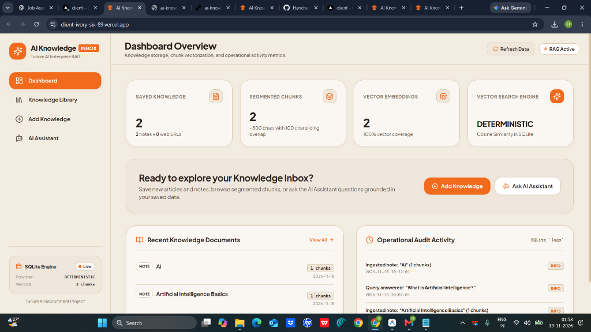
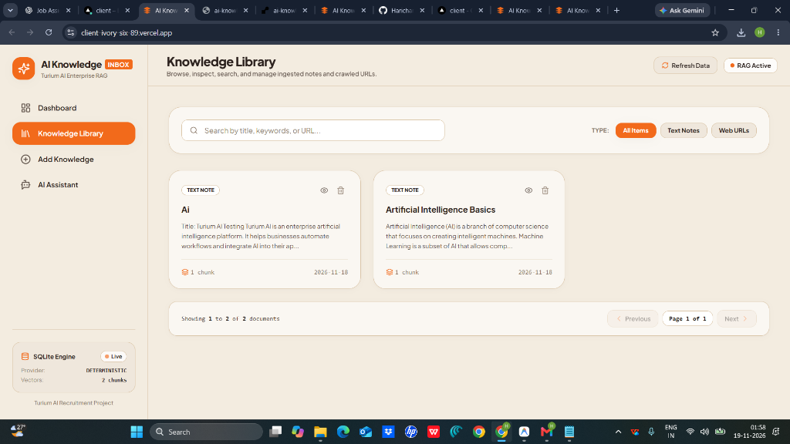
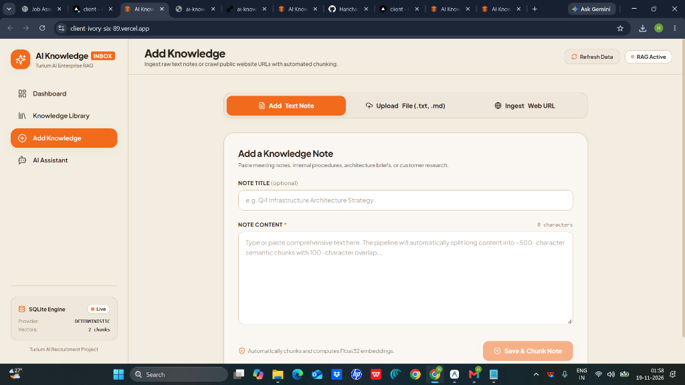
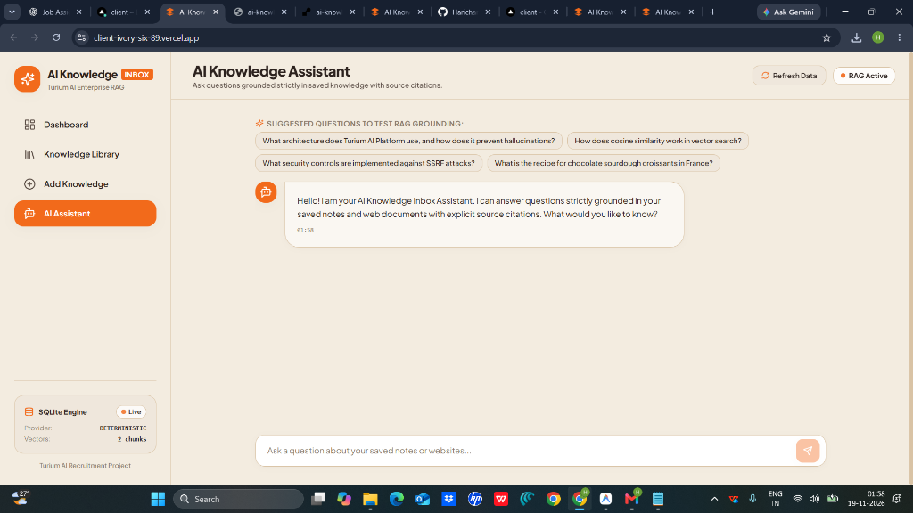

# AI Knowledge Inbox — Turium AI Enterprise RAG

> **Enterprise-Grade AI Knowledge Inbox with Hybrid RAG, BM25 Lexical Search, Dense Vector Similarity, and Transparent Source Citations.**  
> Built as a Technical Recruitment Assignment for **Turium AI**.

[](https://client-ivory-six-89.vercel.app/)
[](https://ai-knowledge-inbox-backend-8btb.onrender.com/api/health)
[](https://github.com/Haricharan2225/AI-Knowledge-Inbox)
[](https://github.com/Haricharan2225/AI-Knowledge-Inbox)
[](https://opensource.org/licenses/ISC)

---

## 🔗 Quick Links

- **Live Application (Frontend)**: [https://client-ivory-six-89.vercel.app/](https://client-ivory-six-89.vercel.app/)
- **Live Backend API (Render)**: [https://ai-knowledge-inbox-backend-8btb.onrender.com/api/health](https://ai-knowledge-inbox-backend-8btb.onrender.com/api/health)
- **GitHub Repository**: [https://github.com/Haricharan2225/AI-Knowledge-Inbox](https://github.com/Haricharan2225/AI-Knowledge-Inbox)

---

## 📸 Application Screenshots

Actual application screenshots from the production deployment on Vercel and Render:

### 1. Dashboard Overview

*Real-time metrics tracking saved knowledge items, chunk vectorization, SQLite engine status, recent ingestion activity, and operational audit logs.*

### 2. Knowledge Library

*Full repository view with 300ms debounced live search, category filtering (`All`, `Text Notes`, `Web URLs`), Previous/Next pagination, item inspection modals, and cascading deletion.*

### 3. Add Knowledge (Text Notes, File Upload & URL Crawling)

*Triple-mode knowledge ingestion supporting rich text notes, client-side `.txt` / `.md` file parsing via browser `FileReader`, and SSRF-protected webpage scraping via Cheerio.*

### 4. AI Assistant (Grounded RAG Chat)

*Conversational assistant answering questions strictly grounded in saved knowledge with clickable `[Source X]` chips, cosine similarity metrics, and zero-hallucination guardrails.*

---

## 🎨 Design System

Strictly adhering to the required **3-color brand palette**:

| Token | Hex Code | Role | Tailwind Token |
| :--- | :--- | :--- | :--- |
| **Cream** | `#F3ECE0` | Primary application canvas background and modal surfaces | `brand-cream` / `bg-[#F3ECE0]` |
| **Sand** | `#D9C3A5` | Cards, secondary surfaces, and subtle divider borders | `brand-sand` / `border-[#D9C3A5]` |
| **Orange** | `#F26A1B` | Primary buttons, active navigation indicators, and highlight accents | `brand-orange` / `bg-[#F26A1B]` |

Neutral typography colors (`#2C221E` Dark Brown for headings, `#5A4D45` Charcoal for body text, `#FFFFFF` White for badges and card fills) are used strictly for hierarchy and readability. No unapproved accent colors (blue, purple, violet, green) are used anywhere in the application.

---

## 🌟 Key Features

1. **Triple Knowledge Ingestion Pipeline**:
   - **Text Notes**: Manual paste or text composition with automatic sentence-boundary chunking.
   - **Local File Upload**: Drag-and-drop or file browser selection of Markdown (`.md`) and plain text (`.txt`) files up to 5MB, processed client-side with native `FileReader`.
   - **Public Web Scraping**: Cheerio-based cleaner removing boilerplate, scripts, navigation, footers, ads, and tracking tags.
   - **Enterprise SSRF Protection**: Validates target URLs and checks DNS resolutions against private subnets (`10.0.0.0/8`, `172.16.0.0/12`, `192.168.0.0/16`, `127.0.0.0/8`), AWS instance metadata (`169.254.169.254`), and local domains (`localhost`, `*.local`).
   - **Content Deduplication**: SHA-256 and URL matching updates documents in-place rather than creating duplicate records.

2. **Advanced Hybrid Retrieval Engine**:
   - **Okapi BM25 Lexical Engine**: In-memory sparse retrieval engine indexing technical acronyms and exact keywords (e.g. `JVM`, `OOP`, `try/catch`).
   - **Dense Vector Search**: High-dimensional semantic embeddings stored as IEEE 754 32-bit floating-point binary BLOBs inside SQLite.
   - **Reciprocal Rank Combination**: Combines sparse BM25 scores and dense cosine similarities to eliminate acronym blindspots.
   - **Adaptive Thresholding**: Filters out candidate chunks scoring below $0.45 \times \text{TopScore}$ to eliminate irrelevant document retrieval.
   - **Diversity Deduplication**: Limits candidate chunks per item and deduplicates identical textual fingerprints.

3. **Strict RAG Generation & Anti-Hallucination Guardrails**:
   - **Zero Hallucination**: Out-of-context questions return an explicit refusal: *"I do not have enough information in the saved knowledge to answer this question."*
   - **Multi-Part Query Decomposition**: Compound questions with multiple sub-questions are parsed, answered individually from context, and synthesized.
   - **Partial Information Transparency**: Questions with partially available knowledge answer the supported component while clearly highlighting what was not found.
   - **Auditable Citations**: Every claim is cited with clickable `[Source X]` chips displaying the document title, chunk preview, and similarity score.

4. **Production Security & Reliability**:
   - **API Rate Limiting**: `express-rate-limit` enforces quotas on `/api/ingest` (20 req/min) and `/api/query` (40 req/min) to prevent abuse and LLM quota exhaustion.
   - **Atomic SQLite Transactions**: Ingestion and deletions execute within `db.transaction()` with foreign keys (`ON DELETE CASCADE`).
   - **WAL Journaling**: SQLite configured with Write-Ahead Logging (`journal_mode = WAL`) and `synchronous = NORMAL` for concurrent read/write throughput.

---

## 🛠 Technology Stack

### Frontend
- **Framework**: React 18
- **Build Tool**: Vite 6 (JavaScript)
- **Styling**: Tailwind CSS 3
- **Icons**: Lucide React
- **HTTP Client**: Native `fetch` with environment-aware baseURL resolution
- **Hosting**: Vercel

### Backend
- **Runtime**: Node.js (v18+)
- **Framework**: Express.js
- **Database**: SQLite 3 via `better-sqlite3`
- **Scraping**: Cheerio
- **Validation**: Zod
- **Logging**: Winston with structured JSON output and request correlation
- **Rate Limiting**: `express-rate-limit`
- **Hosting**: Render

### AI & Retrieval Engine
- **Active Default Provider**: High-Precision Deterministic Vectorizer (768-dim multi-hash subword n-grams) + Grounded Synthesizer (offline, zero-cost, reproducible).
- **Supported Cloud Providers**: Google Gemini (`text-embedding-004` + `gemini-1.5-flash`) and OpenAI (`text-embedding-3-small` + `gpt-4o-mini`).

---

## 📁 Repository Folder Structure

```
AI-Knowledge-Inbox/
├── .env.example                     # Root environment configuration template
├── .gitignore                       # Strict exclusions for credentials, DB, and builds
├── README.md                        # Project documentation (this file)
├── package.json                     # Root orchestrator scripts (dev, test, build)
├── package-lock.json
├── render.yaml                      # Render Blueprint infrastructure specification
├── docs/
│   └── screenshots/                 # Production application screenshots
│       ├── dashboard.png
│       ├── knowledge-library.png
│       ├── add-knowledge.png
│       └── ai-assistant.png
├── server/                          # Node.js + Express + SQLite Backend
│   ├── .env.example                 # Backend environment variable template
│   ├── package.json                 # Backend dependencies & test scripts
│   ├── package-lock.json
│   ├── data/                        # Persistent SQLite database directory
│   │   └── knowledge.db             # SQLite database file (ignored by Git)
│   └── src/
│       ├── app.js                   # Express app with CORS, static serving & routes
│       ├── server.js                # Server entry point with graceful shutdown hooks
│       ├── config/
│       │   ├── database.js          # SQLite connection, WAL mode & schema setup
│       │   ├── env.js               # Runtime environment validation via Zod
│       │   └── logger.js            # Winston structured logger
│       ├── controllers/
│       │   ├── ingestController.js  # Text/URL/File ingestion & transaction handling
│       │   ├── itemController.js    # Item CRUD, chunk details, pagination & stats
│       │   └── queryController.js   # RAG question handling & audit logging
│       ├── middleware/
│       │   ├── errorHandler.js      # Centralized error handler with Zod formatting
│       │   ├── rateLimiter.js       # express-rate-limit configuration
│       │   └── requestLogger.js     # HTTP request timing & logging
│       ├── routes/
│       │   └── api.js               # API router (/api/ingest, /api/query, /api/items, etc.)
│       ├── services/
│       │   ├── scraperService.js    # SSRF-safe Cheerio web scraper
│       │   ├── chunkingService.js   # Sentence-aware chunker with overlap
│       │   ├── embeddingService.js  # Multi-provider vector generator
│       │   ├── bm25Service.js       # In-memory Okapi BM25 lexical engine
│       │   ├── vectorStore.js       # Hybrid search & SQLite vector persistence
│       │   ├── llmService.js        # Grounded answer synthesis engine
│       │   └── ragService.js        # End-to-end RAG orchestrator
│       ├── utils/
│       │   └── similarity.js        # Cosine similarity math & Float32 BLOB buffer utils
│       └── tests/
│           ├── phase2_test.js       # Ingestion & scraper tests (6/6)
│           ├── phase3_test.js       # Vector math & storage tests (6/6)
│           ├── phase4_test.js       # RAG query & citation tests (6/6)
│           ├── stage2_test.js       # Rate limiter & file ingestion tests (3/3)
│           └── rag_accuracy_test.js # 8-Scenario RAG accuracy benchmark (8/8)
└── client/                          # React + Vite + Tailwind CSS Frontend
    ├── .env.example                 # Frontend environment variable template
    ├── index.html                   # HTML template with Google Fonts
    ├── package.json                 # Frontend dependencies
    ├── package-lock.json
    ├── postcss.config.js
    ├── tailwind.config.js           # Brand color tokens (Cream, Sand, Orange)
    ├── vercel.json                  # Vercel SPA routing rewrites
    ├── vite.config.js               # Vite config with local proxy to :5000
    └── src/
        ├── main.jsx                 # React root mount
        ├── App.jsx                  # Main layout container & view orchestrator
        ├── components/
        │   └── layout/
        │       ├── Header.jsx       # Header with refresh button & RAG status
        │       └── Sidebar.jsx      # Navigation sidebar with live SQLite stats
        ├── pages/
        │   ├── Dashboard.jsx        # Analytics cards, recent items & logs feed
        │   ├── KnowledgeLibrary.jsx # Debounced search, pagination & chunk inspector
        │   ├── AddKnowledge.jsx     # Text, URL, and File drag-and-drop ingestion
        │   └── AIAssistant.jsx      # Grounded RAG conversation interface
        ├── services/
        │   └── api.js               # Centralized API client with VITE_API_URL support
        └── styles/
            └── index.css            # Tailwind directives & custom scrollbars
```

---

## 🏗 System Architecture

```
┌─────────────────────────────────────────────────────────────────────────────┐
│                       REACT FRONTEND (Vite / Vercel)                        │
│  • Dashboard (Live Metrics, Logs)     • Add Knowledge (Text, URL, Files)    │
│  • Knowledge Library (Search, Filter) • AI Assistant (Hybrid RAG Chat)      │
└──────────────────────────────────────┬──────────────────────────────────────┘
                                       │ HTTPS REST Calls (VITE_API_URL)
┌──────────────────────────────────────▼──────────────────────────────────────┐
│                    NODE.JS / EXPRESS BACKEND (Render)                       │
│  • express-rate-limit (20 req/min Ingest, 40 req/min Query)                 │
│  • Zod Payload Schema Validation & Centralized Error Handler                │
│  • Winston JSON Structured Logging with Request Timing Metrics              │
│  • Ingest Controller: Deduplication, SSRF Scraper, Semantic Chunker         │
│  • Hybrid Vector Engine: BM25 Lexical Scoring + Dense Cosine Similarity     │
│  • RAG Query Engine: Multi-part Decomposition & Strict Citation Grounding   │
└──────────────────────────────────────┬──────────────────────────────────────┘
                                       │ better-sqlite3 (WAL Mode, Float32 BLOBs)
┌──────────────────────────────────────▼──────────────────────────────────────┐
│                            SQLITE DATABASE                                  │
│  • items: Document metadata, content hash, URL source                       │
│  • chunks: ~500-char segments, ~100-char overlap, IEEE 754 vector BLOBs     │
│  • logs: Operational audit logs with query latency and metadata             │
└─────────────────────────────────────────────────────────────────────────────┘
```

---

## 🔄 Ingestion & Retrieval Workflows

### 1. Text Ingestion Workflow
```
[User Text] ──> [Zod Validation] ──> [Deduplication Check] ──> [Sentence Chunker]
                                                                        │
                                                                        ▼
[SQLite: items] <── [Atomic Transaction] <── [Vector Embeddings] <──────┘
[SQLite: chunks]
[SQLite: logs]
```

### 2. URL Ingestion Workflow
```
[Public URL] ──> [SSRF Guard: DNS Check & Subnet Blacklist] ──> [HTTP Fetch (10s Timeout)]
                                                                        │
                                                                        ▼
[SQLite: items + chunks] <── [Chunk & Embed] <── [Cheerio: Strip Nav, Scripts, Ads]
```

### 3. File Ingestion Workflow (`.txt` and `.md`)
```
[File Drag & Drop] ──> [Validate Extension & Size (<5MB)] ──> [Browser FileReader API]
                                                                        │
                                                                        ▼
[SQLite: items + chunks] <── [Atomic Ingestion Pipeline] <── [Preview & Title Confirmation]
```

---

## 🧩 Chunking & Vector Search Architecture

### Chunking Strategy ([`chunkingService.js`](file:///c:/Users/Haricharan/Desktop/AI-Knowledge-Inbox/server/src/services/chunkingService.js))
- Splits text into atomic semantic units using sentence boundary regex lookarounds: `(?<=[.!?])\s+`.
- Sentences are kept whole whenever possible; mid-sentence cuts only occur if an individual sentence exceeds the target size.
- **Target Chunk Size**: ~500 characters.
- **Sliding Overlap**: ~100 characters backtracking to guarantee semantic continuity across boundaries.

### Vector Storage & Cosine Similarity ([`similarity.js`](file:///c:/Users/Haricharan/Desktop/AI-Knowledge-Inbox/server/src/utils/similarity.js))
- Vector embeddings are serialized into raw binary Node.js `Buffer` objects using the IEEE 754 32-bit float format (`Float32Array`) and stored as `BLOB` columns in SQLite.
- Normalized Cosine Similarity formula:
$$\text{CosineSimilarity}(\vec{u}, \vec{v}) = \frac{\vec{u} \cdot \vec{v}}{\|\vec{u}\|_2 \cdot \|\vec{v}\|_2}$$

### Hybrid Retrieval & Ranking ([`vectorStore.js`](file:///c:/Users/Haricharan/Desktop/AI-Knowledge-Inbox/server/src/services/vectorStore.js))
1. **Dense Vector Search**: Generates query vector and computes cosine similarity against all stored Float32 BLOB chunks.
2. **Sparse BM25 Indexing**: In-memory Okapi BM25 engine computes term frequency / inverse document frequency over chunk tokens, giving exact acronym matches (e.g., `JVM`, `OOP`) a significant precision boost.
3. **Score Combination**:
$$\text{HybridScore} = 0.45 \cdot \text{CosineSimilarity} + 0.55 \cdot \text{NormalizedBM25}$$
4. **Adaptive Noise Thresholding**: Discards any chunk scoring below $0.45 \times \text{TopScore}$. If the top match is below $0.12$, triggers the zero-hallucination guardrail immediately.
5. **Diversity Deduplication**: Limits chunks per item to 2 and eliminates identical text fingerprints.

---

## 🤖 RAG Answer Generation & Citations

Implemented in [`llmService.js`](file:///c:/Users/Haricharan/Desktop/AI-Knowledge-Inbox/server/src/services/llmService.js) and [`ragService.js`](file:///c:/Users/Haricharan/Desktop/AI-Knowledge-Inbox/server/src/services/ragService.js):

- **Zero-Hallucination Prompt**:
  > *"ONLY answer using facts directly mentioned in the provided Context Excerpts. If the excerpts do not contain enough information to answer truthfully, state: 'I do not have enough information in the saved knowledge to answer this question.'"*
- **Multi-Part Decomposition**: Compound queries (e.g. *"What is OOP? What is JVM? What keywords for exceptions?"*) are automatically decomposed into atomic sub-questions, evaluated against the context independently, and synthesized.
- **Partial Knowledge Transparency**: Supported claims are cited while unmentioned topics are explicitly flagged (*"Information regarding '...' was not found in the saved knowledge."*).
- **Citation Filtering**: Only chunks referenced in the generated answer retain `isCited: true`. Uncited candidate chunks are filtered out from the final response.

---

## 🔌 API Endpoint Documentation

| Method | Endpoint | Description | Rate Limit |
| :--- | :--- | :--- | :--- |
| `POST` | `/api/ingest` | Ingests text notes, uploaded files, or public URLs. Chunks and embeds content in SQLite. | **20 req/min** |
| `POST` | `/api/query` | RAG query: Retrieves Top-K chunks via hybrid search and generates a cited answer. | **40 req/min** |
| `GET` | `/api/items` | Retrieves saved documents with type filtering (`all`, `note`, `url`), search, and pagination (`limit`, `offset`). | Unlimited |
| `GET` | `/api/items/:id` | Retrieves full document details with all individual segmented text chunks. | Unlimited |
| `DELETE` | `/api/items/:id` | Cascading deletion of an item and its associated vector chunks. | Unlimited |
| `GET` | `/api/stats` | Aggregated dashboard metrics (item counts, chunks, vector coverage, audit logs). | Unlimited |
| `GET` | `/api/search` | Direct semantic search endpoint across stored chunks using cosine similarity. | Unlimited |
| `GET` | `/api/health` | System health check reporting SQLite status, table verification, and active vector provider. | Unlimited |

---

## ⚙️ Environment Variables

### Backend (`server/.env`)
| Variable | Required | Default | Description |
| :--- | :--- | :--- | :--- |
| `PORT` | Optional | `5000` | HTTP port for the Express backend (Render sets dynamically). |
| `NODE_ENV` | Optional | `development` | Environment mode (`development`, `production`, `test`). |
| `DATABASE_PATH` | Optional | `./data/knowledge.db` | Path to SQLite file. Set to `/var/data/knowledge.db` if using a Render Persistent Disk. |
| `LOG_LEVEL` | Optional | `info` | Winston logging level (`error`, `warn`, `info`, `debug`). |
| `GEMINI_API_KEY` | Optional | `""` | Google Gemini API key. If omitted, uses deterministic vectorizer & synthesizer. |
| `OPENAI_API_KEY` | Optional | `""` | OpenAI API key. If omitted, uses deterministic vectorizer & synthesizer. |

### Frontend (`client/.env`)
| Variable | Required | Default | Description |
| :--- | :--- | :--- | :--- |
| `VITE_API_URL` | Optional | `/api` | Base URL of the backend API (e.g. `https://ai-knowledge-inbox-backend-8btb.onrender.com`). |

---

## 💻 Local Installation & Setup

### Prerequisites
- **Node.js**: v18.0.0 or higher
- **npm**: v9.0.0 or higher

### 1. Clone the Repository
```bash
git clone https://github.com/Haricharan2225/AI-Knowledge-Inbox.git
cd AI-Knowledge-Inbox
```

### 2. Install All Dependencies
```bash
npm run install:all
```
*(Installs root, server, and client dependencies in one command).*

### 3. Configure Environment Files
```bash
# Server configuration
cp server/.env.example server/.env

# Client configuration (optional for local development)
cp client/.env.example client/.env
```

### 4. Run Development Servers
```bash
npm run dev
```
- **Frontend**: [http://localhost:3000](http://localhost:3000)
- **Backend**: [http://localhost:5000](http://localhost:5000)
- **Health Check**: [http://localhost:5000/api/health](http://localhost:5000/api/health)

---

## 🚀 Cloud Deployment Instructions

### 1. Render (Backend Deployment)
The repository includes a ready-to-use [`render.yaml`](file:///c:/Users/Haricharan/Desktop/AI-Knowledge-Inbox/render.yaml) blueprint:
1. Log in to [dashboard.render.com](https://dashboard.render.com).
2. Click **New +** $\to$ **Blueprint** $\to$ select `Haricharan2225/AI-Knowledge-Inbox`.
3. Render automatically sets:
   - **Root Directory**: `server`
   - **Build Command**: `npm install`
   - **Start Command**: `npm start`
   - **Health Check Path**: `/api/health`
4. Add environment variables:
   - `NODE_ENV` = `production`
   - `DATABASE_PATH` = `./data/knowledge.db`
   - `LOG_LEVEL` = `info`
5. *(Optional)* If using a Render Persistent Disk (Starter plan), mount the disk to `/var/data` and set `DATABASE_PATH=/var/data/knowledge.db`.

### 2. Vercel (Frontend Deployment)
1. Log in to [vercel.com](https://vercel.com) $\to$ **Add New Project** $\to$ Import `Haricharan2225/AI-Knowledge-Inbox`.
2. Configure project settings:
   - **Framework Preset**: `Vite`
   - **Root Directory**: `client`
   - **Build Command**: `npm run build`
   - **Output Directory**: `dist`
3. In **Environment Variables**, add:
   - `VITE_API_URL`: Your Render backend URL (e.g. `https://ai-knowledge-inbox-backend-8btb.onrender.com`).
4. Click **Deploy**. SPA rewrites are handled automatically by [`client/vercel.json`](file:///c:/Users/Haricharan/Desktop/AI-Knowledge-Inbox/client/vercel.json).

---

## 🧪 Testing & Automated Verification

Run the entire test suite covering all 29 automated assertions:
```bash
npm test
```

### Test Suite Breakdown:
1. **Phase 2 Ingestion Tests (`server/src/tests/phase2_test.js`)**:
   - Sample text ingestion with chunking (3 chunks).
   - Public URL scraping (`example.com`).
   - SSRF security blocking (`127.0.0.1`, `localhost`).
   - Empty input validation (HTTP 400).
   - SQLite foreign keys & audit logging.
   - Chunk sizes (~500 chars) and sliding overlap (~100 chars).
2. **Phase 3 Vector Engine Tests (`server/src/tests/phase3_test.js`)**:
   - Cosine similarity unit math (bounds $1.00$, $0.00$, $-1.00$, dimension mismatches).
   - SQLite BLOB buffer serialization and IEEE 754 float precision.
   - Embedding generation and semantic discrimination.
   - SQLite chunks table vector storage.
   - Semantic vector search and Top-K ranking.
   - 100% embedding coverage verification.
3. **Phase 4 RAG Query Tests (`server/src/tests/phase4_test.js`)**:
   - Relevant question answering with grounded citations.
   - Out-of-context question rejection without hallucination.
   - Citation metadata integrity (`title`, `chunkId`, `similarity`, `excerpt`).
   - Input validation (empty/whitespace queries).
   - Document-scoped querying via `itemId` filter.
   - Operational audit logging in SQLite.
4. **Stage 2 Feature Tests (`server/src/tests/stage2_test.js`)**:
   - Rate limiting enforcement (HTTP 429 and `RateLimit-*` headers).
   - Live endpoint rate limiting integration.
   - Local `.txt` and `.md` file ingestion simulation.
5. **RAG Retrieval Benchmark Suite (`server/src/tests/rag_accuracy_test.js`)**:
   - Scenario 1: Exact Question Matching (OOP Principles).
   - Scenario 2: Semantic Question with Different Wording (JVM acronym).
   - Scenario 3: Compound Multi-Concept Question (OOP + JVM + Exceptions).
   - Scenario 4: Partially Available Information.
   - Scenario 5: Completely Unrelated Question (Quantum Computing refusal).
   - Scenario 6: Vector Similarity Concept.
   - Scenario 7: Platform Architecture Query.
   - Scenario 8: Ingestion Deduplication Integrity.

---

## ⚖️ Design Decisions & Trade-offs

1. **SQLite with `better-sqlite3` vs. External Vector Database**:
   - *Rationale*: Zero external infrastructure dependencies. Blazing fast synchronous in-process operations without network socket overhead.
   - *Trade-off*: Performs a linear scan over float vectors in memory, which delivers sub-millisecond retrieval up to ~25,000 chunks, but would require an Approximate Nearest Neighbor (ANN) index (e.g. `sqlite-vss` or pgvector) for millions of records.
2. **Hybrid BM25 + Dense Cosine Similarity vs. Pure Vector Retrieval**:
   - *Rationale*: Pure dense vectors frequently experience collisions on short technical acronyms (e.g., `JVM`, `OOP`, `SSRF`). BM25 provides exact sparse token matching, eliminating acronym retrieval failures.
3. **Deterministic Local Fallback vs. Mandatory Cloud API Keys**:
   - *Rationale*: Allows recruiters, developers, and automated test runners to clone and test the entire application end-to-end with zero API keys or monthly costs. Instantly upgrades to Gemini or OpenAI when API keys are configured.
4. **Client-Side `FileReader` vs. Multipart Server Uploads**:
   - *Rationale*: Text and Markdown files are read directly into memory in the browser, eliminating the need for temporary disk staging, multer dependencies, or S3 buckets.

---

## ⚠️ Known Limitations

1. **Render Free-Tier Storage Ephemerality**:
   - On Render's Free tier, the SQLite database file resides on an ephemeral disk. The database persists across HTTP requests, but will reset to the Git checkout state if the service spins down or redeploys. To maintain permanent persistence, attach a Render Persistent Disk mounted to `/var/data`.
2. **Linear Vector Scan at Scale**:
   - Cosine similarity is computed directly across stored chunk vectors. While exceptionally fast ($<5\text{ms}$) for repositories under 10,000 chunks, massive datasets ($>100,000$ chunks) would benefit from an HNSW / IVF index.
3. **Single Workspace / Single-Tenant**:
   - All saved items share a unified knowledge inbox without multi-user tenant separation or role-based access control.

---

## 🔮 Future Improvements

1. **Hierarchical Parent-Child Chunking**:
   - Index smaller child chunks (~150 chars) for precise vector retrieval while injecting their larger parent section (~1,200 chars) into the LLM context.
2. **Cross-Encoder Re-Ranking**:
   - Introduce a lightweight cross-encoder model (e.g., `bge-reranker-small`) after the hybrid BM25/Cosine step to further sharpen subtle semantic boundaries.
3. **PDF & Office Document Parsing**:
   - Extend the file ingestion tab to support `.pdf` and `.docx` using `pdf-parse` and `mammoth`.
4. **Multi-User Authentication**:
   - Add JWT-based user authentication and multi-tenant inbox isolation.

---

## 👤 Author Information

- **Author**: Haricharan
- **Email**: [haripatel2225@gmail.com](mailto:haripatel2225@gmail.com)
- **GitHub**: [@Haricharan2225](https://github.com/Haricharan2225)
- **Project Repository**: [https://github.com/Haricharan2225/AI-Knowledge-Inbox](https://github.com/Haricharan2225/AI-Knowledge-Inbox)
- **Live Demo**: [https://client-ivory-six-89.vercel.app/](https://client-ivory-six-89.vercel.app/)
